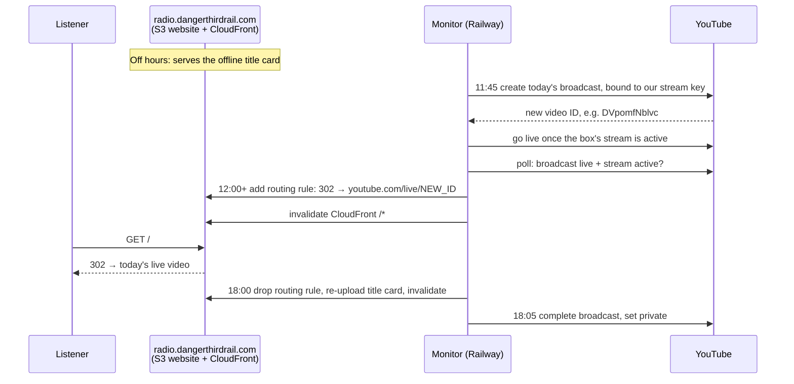
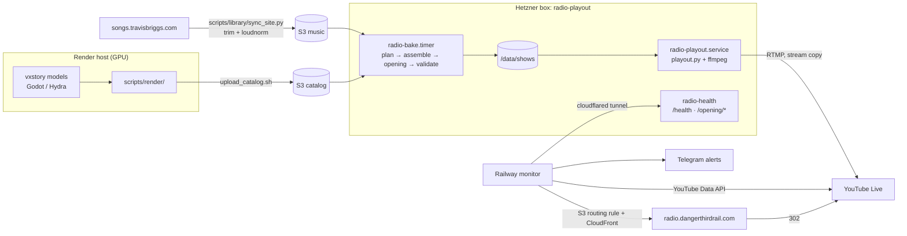
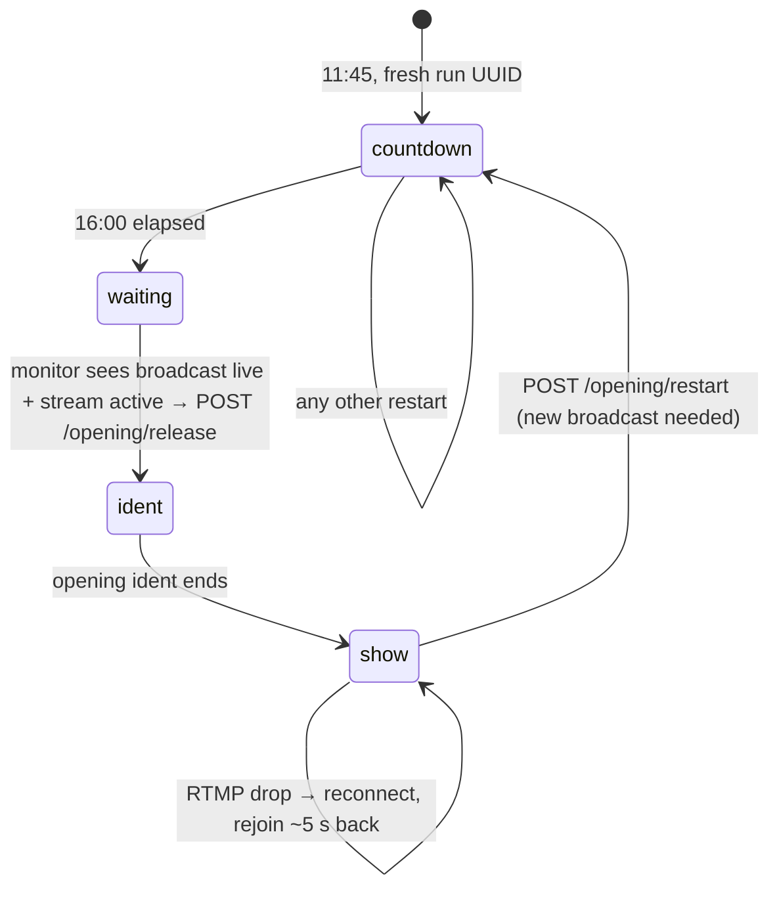

# 📻 Danger Third Rail Radio

**Six hours of original music a day, over generative visuals no camera ever saw, live on YouTube.**

👉 **[radio.dangerthirdrail.com](https://radio.dangerthirdrail.com)** 👈 &nbsp;·&nbsp; daily, **12:00 to 18:00 Pacific**

**One URL, forever.** YouTube mints a brand-new video ID for every broadcast, but you never
need to know it: each day the station flips its own domain from the offline title card to
that day's fresh live video, then back again at close. No one touches anything.

Every night a box in a Hetzner datacenter wakes at 3 AM, shuffles ~165 songs from
[songs.travisbriggs.com](https://songs.travisbriggs.com), cuts them against a catalog of
GPU-rendered [vxstory](https://github.com/audiodude/vxstory) pieces (supernovae, fluid
swirls, peg cascades, cities rising from nothing), and bakes the whole show into one
file. At 11:45 a 16-minute countdown goes up on YouTube. At zero, once YouTube actually
confirms the broadcast is live, an ident plays and the music starts. At 18:05 it all goes
dark until tomorrow.

Nothing is rendered live. The stream is a single stream copy of a pre-baked file, so the
box just pushes bytes to YouTube.

---

## 🗓️ A day on air (Pacific time)

| Time | What happens |
|---|---|
| **03:00** | `radio-bake.timer` fires: sync music + catalog from S3, plan, assemble, render the opening, validate, publish (~2.5 h for a 6 h show) |
| **11:45** | Operational window opens. Playout starts the **16-minute silent countdown**; the monitor creates the day's broadcast |
| **12:00** | Consumer window opens. As soon as the broadcast is `live` with an active stream, **`radio.dangerthirdrail.com` flips from the title card to a 302 → today's brand-new `youtube.com/live/<id>`** |
| **12:01** | Countdown hits zero. Playout **holds** until the monitor sees the broadcast `live` with an active stream, then plays the opening ident, then song #1 from its first note |
| **18:00** | Consumer window closes: **redirect drops, the title card is back** |
| **18:05** | Playout stops; broadcast is completed and set private. Tomorrow's broadcast will get a new ID |

Why not 24/7? YouTube deranks channels that never stop streaming. Six hours, then off.

## 🔀 The daily switchover: one domain, a new YouTube ID every day

Every broadcast YouTube creates gets a fresh video ID, so yesterday's link is dead by
design. The monitor owns `radio.dangerthirdrail.com` and repoints it every day, with no
DNS changes, no deploys, and nobody at a keyboard:



- **Online** is a single S3 website routing rule: `302` to `www.youtube.com/live/<id>`,
  then a CloudFront `/*` invalidation so the edge picks it up immediately
  ([`monitor/redirect.py`](monitor/redirect.py)).
- **Offline** removes the rule, re-uploads the [title card](assets/radio-offline.html) as
  `index.html` (`max-age=60`), and invalidates again.
- It's **reconciled, not scheduled**: every poll compares the bucket's current target with
  the broadcast that's actually `live` with an active stream
  ([`monitor/reconcile.py`](monitor/reconcile.py)). Not live yet? The title card stays up.
  Broadcast replaced mid-day? The redirect follows the new ID on the next poll. Stream
  gone? Back to the title card. Monitor restarted? It reads the target from the bucket and
  carries on.
- **302, never 301.** The target changes every day; a browser that cached a 301 would be
  stuck on a dead video forever.

## 🏗️ How it fits together



| Piece | Where | Job |
|---|---|---|
| **Render** | [`scripts/render/`](scripts/render/) on a GPU machine | Turn vxstory model + preset + seed into 720p mp4s + `catalog.json` |
| **Library** | [`scripts/library/`](scripts/library/README.md) | Mirror the songs site into S3, trimmed and normalized to −21 LUFS |
| **Bake** | [`scripts/bake/`](scripts/bake/) on the box | Plan + render tomorrow's show and its opening into `/data/shows` |
| **Broadcast** | [`scripts/broadcast/`](scripts/broadcast/) on the box | Window-gated playout, opening gate, reconnects, health API |
| **Monitor** | [`monitor/`](monitor/README.md) on Railway | Owns the YouTube broadcast lifecycle, the redirect, and alerts |

## 🎨 Content: rendering the video catalog

Pieces come from the [vxstory](https://github.com/audiodude/vxstory) models
(`supernova_orbit`, `fluid_swirl`, `peg_cascade`, `chromatic_cascade`, `matter_cycle`,
`radial_burst`, `metro_rise`, `hydra`, …), rendered by composable helpers on a machine
with a GPU and a vxstory checkout (`VXSTORY_DIR`, default `../vxstory`):

```bash
# one piece: model, preset, seed, duration, out dir (+ optional --kind ident)
scripts/render/render_piece.sh supernova_orbit odyssey 101 1200 ./catalog
# a whole catalog from a committable spec (see scripts/render/specs/)
scripts/render/render_catalog.sh scripts/render/specs/long-600.json ./catalog
# push to S3: mp4s first, manifest last, so the manifest never references missing files
scripts/render/upload_catalog.sh ./catalog s3://bucket/catalog/
```

- Pieces render at the models' native **1920×1080@60** (Movie Maker captures the project
  viewport, so shrinking it would crop rather than scale), then get a Lanczos downscale to
  **1280×720** in the mp4 encode, which doubles as supersampling AA.
- Each mp4 gets a sidecar JSON; `make_manifest.py` collects them into
  `catalog.json`: `{"pieces": [{id, kind: piece|ident, model, preset, seed, duration_sec, file, rendered_at}]}`.
- Renders are serialized (one GPU), idempotent (existing mp4s are skipped, writes are
  atomic), and run about **6× realtime on a 3080 Ti** (~29 min per 300 s piece, encode included).
- **Hydra** (original Hydra sketches; presets `cells`, `weave`, `glass`, `chrome`, `fold`)
  renders through vxstory's own `hydra/render.mjs` in headless GPU Chromium instead of
  Godot. `render_piece.sh` picks it whenever the model dir has a `render.mjs`. One-time
  setup in the vxstory checkout (Node ≥ 24):
  `cd hydra && npm ci && npx playwright install chromium-headless-shell`.

The next nightly bake picks new pieces up automatically.

### 🪧 Idents

Idents are the short station-ID bumpers between stretches. They can be rendered
(`--kind ident`) or **hand-made**: drop an mp4 in the catalog dir with a sidecar (`model`
can be anything, e.g. `handmade`). Optional sidecar fields steer the bake:

| Field | Effect |
|---|---|
| `weight` | Relative odds of being drawn at each transition (default `1`) |
| `opening: true` | Eligible to open the broadcast. With none flagged, any ident may |
| `filler: true` | Plays when nothing else is available, even right after itself (`text_ident_plz_ignore_s1` is the filler) |

A **silent** ident straddles its song boundary with the music running underneath. An ident
**with audio** is a proper break: the music pauses for it and the rest of the show slides
later by its length.

## 🎵 Music library

The S3 library mirrors [songs.travisbriggs.com](https://songs.travisbriggs.com)'s public
`songs.json`. Every upload is trimmed of mastered-in silence and **loudness-normalized,
gain only**, to the on-air level of **−21 LUFS / ≤ −1 dBTP**. The bake plays files as-is.

```bash
python3 scripts/library/sync_site.py           # dry run: + uploads, ~ re-processing, - removals
python3 scripts/library/sync_site.py --apply   # actually change S3
```

`scripts/bake/song_denylist.txt` keeps songs (covers, over-length tracks) off air even when
they're in the library. Full details, including why −21 and not −14:
[`scripts/library/README.md`](scripts/library/README.md).

## 🍞 The bake: how a show gets planned

`scripts/bake/bake.sh` runs **plan → assemble → opening → validate → publish**. The plan
is deterministic: the date is the seed, so a given night's show can always be re-derived.

- **Music**: endless seeded shuffle of the library (never the same song twice in a row,
  even across a pass seam) until the target length (`SHOW_DUR`, default 22800 s ≈ 6.3 h) is filled.
- **Ident spacing**: at least **two songs apart** (the opening ident counts as sitting
  before song #1), never the same ident twice in a row except the filler, and never before
  `BAKE_DWELL` seconds of the current stretch have played.
- **Uncut vs cut**: each stretch between idents is drawn **uncut** (75%, `UNCUT_SHARE` in
  `scripts/bake/plan.py`), one piece long enough to cover the whole stretch, which is what
  the 600 s pieces are for, or **cut**: a hard cut to a new piece at each song boundary.
  With no piece long enough, uncut falls back to cut.
- **Rotation**: pieces go least-recently-used and never play twice in a row. Each segment
  starts at a random in-point so repeats don't always open on the same frames.
- **Song budget**: a song longer than `shortest piece − dwell` can't fit and is dropped
  (listed as `excluded_songs` in the plan). Render longer pieces to bring long tracks back.
- **Titles**: each song's name is burned in as a `♪ Song Title` ASS subtitle that fades in
  and out.
- **Encode**: one video encode pass, H.264 **CBR** (`BAKE_VBITRATE`, default 6 Mbps) at
  720p60 with fixed GOPs, so the result is safe to stream-copy straight to RTMP.

Output lands in `/data/shows`: `show-<date>.mkv` + `.plan.json`, plus the opening bundle
(`.countdown.mkv`, `.hold.mkv`, `.ident.mkv`, `.opening.json`). Everything is published to
S3 before `LATEST` moves, and both local and S3 copies older than `RETENTION_DAYS` (3) are pruned.

## 🚦 The opening gate

The first song never plays to an empty room. Playout runs this sequence on **one**
stream-copied RTMP connection:



- The countdown and zero hold match the website title card: big red uppercase
  `DANGER THIRD RAIL` over `RADIO`, a white `HH:MM:SS` timer, the gray domain on black.
- **Only an observed `live` broadcast with an active stream releases the music.** A
  successful transition request, or the `testing` state, is not enough.
- Every transport attempt gets a new UUID; `/opening/release` and `/opening/restart`
  must quote it, so a stale command from an earlier connection gets a 409.
- YouTube resets RTMP connections now and then. After release, playout reconnects within
  seconds and **rejoins the show where it left off**, backing up `RESUME_BACKUP_SEC` (5 s)
  to the previous keyframe. A drop before release starts a fresh countdown.
- A show without its opening bundle is refused. There is no direct-to-show fallback.

## 🛰️ The monitor

A small Python loop on Railway ([`monitor/`](monitor/README.md)): gather state (windows,
broadcasts, stream status, box health) → pure `reconcile.plan_actions` → execute → alert →
sleep until the next poll (`POLL_INTERVAL`, 120 s) or window edge.

- Creates the day's broadcast with **pinned** `BROADCAST_TITLE` / `BROADCAST_DESCRIPTION`,
  bound to the stream whose key matches `YOUTUBE_STREAM_KEY`. Studio edits don't carry over
  to tomorrow; the env vars do.
- Releases or restarts the opening on the box over the Cloudflare tunnel
  (`radio-sys.dangerthirdrail.com`, bearer-authed, `DangerThirdRailMonitor/1.0` user agent).
- Drives the [daily switchover](#-the-daily-switchover-one-domain-a-new-youtube-id-every-day)
  of `radio.dangerthirdrail.com` between the title card and today's live video ID.
- Telegram alerts when things degrade. `FORCE_ACTIVE=1` makes it always-on for testing.

## 🛠️ Operating it

The [**go-live runbook**](docs/go-live-runbook.md) is the source of truth for deploys,
rollouts, and the full verification list. The greatest hits:

```bash
# bake by hand (normally the 03:00 timer does it)
ssh radio-playout 'sudo systemctl start radio-bake.service'
ssh radio-playout 'journalctl -u radio-bake -f'

# is it alive? (playout_alive, ffmpeg_alive, heartbeat_age_s, opening phase)
curl -A DangerThirdRailMonitor/1.0 -H "Authorization: Bearer $BOX_HEALTH_TOKEN" https://radio-sys.dangerthirdrail.com/health

# 🔴 KILL SWITCH: off air now, and stay off
ssh radio-playout 'sudo systemctl stop radio-playout'
ssh radio-playout 'sudo systemctl disable radio-playout radio-bake.timer'
```

**Deploys.** The monitor deploys from the `release` branch on Railway (merge `main` →
`release` with a regular merge, never a squash). The box runs a checkout in `/opt/radio`;
bake and broadcast script changes ship by updating it, ideally outside the window. Some
changes (opening gate, health API) must ship to the box and the monitor together: see the
runbook's rollout order.

**Local playout without YouTube.** Set `OUTPUT` to a file path to write FLV locally
(no stream key needed), `WINDOW_CMD=true` to ignore the schedule, and private paths for
`PLAYOUT_STATE`, `PLAYOUT_RELEASE`, `PLAYOUT_RESTART`, `PLAYOUT_HEARTBEAT`. The live gate
still applies, so you'll have to release it yourself.

## 🧪 Tests

Decoded-media fixtures and a local HTTP harness exercise the bake, the opening gate, and
the monitor without touching YouTube:

```bash
uv run --with pytest --with boto3 python -m pytest monitor/tests scripts/broadcast/tests scripts/bake/tests -q
```

## 🩹 Scar tissue

Things this station learned the hard way, and the design they left behind:

- **"The stream dies after ~30 s."** The old live pipeline under-supplied frames at
  transitions and slowly drained YouTube's buffer. Lesson: never let the encoder starve.
  Today's answer is even simpler: pre-bake everything and stream-copy.
- **Pinned, not cloned.** The monitor once cloned title, description *and* bound stream from
  the newest broadcast on the account. A test broadcast on a second key became "newest", so
  production got bound to the test key, auto-start never fired, and a ~16-minute
  create/stale/delete loop followed. Broadcasts are now bound by stream key with pinned
  metadata, so **test broadcasts on another key can't touch production**.
- **403 `invalidTransition` at every go-live.** YouTube defaults `enableMonitorStream` to
  true, and such a broadcast can't go `ready → live` without passing through `testing`.
  Broadcasts are now created with it off, with a `testing` fallback for old ones.
- **2:17 of dead air.** One "mp3" was actually AIFF/PCM; the concat demuxer can't switch
  decoders mid-stream and decoded it to nothing. Every song is now decoded to identical PCM
  and clamped to its planned slot before concat.
- **Cloudflare vs Python.** Cloudflare challenged Python's default user agent, hence the
  monitor's `DangerThirdRailMonitor/1.0` identity.
- **No 301s, ever.** The redirect target changes daily; browsers cache 301s forever.

## 📚 More docs

- [Go-live runbook](docs/go-live-runbook.md): render → catalog → bake → playout → monitor, rollout order, kill switch
- [Monitor](monitor/README.md): env vars and the first-song gate protocol
- [Music library tools](scripts/library/README.md): sync, normalization, silence cleanup
- [Design specs and plans](docs/superpowers/): the monitor and box-side playout designs
- [TODO.md](TODO.md): content and infrastructure roadmap

---

## 🦴 Fossil record

Before vxstory, this station was a **Godot Galton board** (a bean machine raining balls
into a bell curve, with live chat reactions) streamed 24/7 from Railway. Its code is still
here; its Railway `galton-stream` service and volume were deleted on 2026-10-18.

<details>
<summary>🎲 Galton board simulator (Godot 4.4+)</summary>

Balls spawn from a funnel, bounce through 12 rows of pegs between concave walls, and
collect in bins that blend the colors of every ball they catch (2–3 random colors per
round). A histogram overlay tracks the curve, pegs flash when touched, and the board
resets after 472–512 balls.

```bash
godot --path . --main-scene main.tscn   # ESC quits
```

**Chat IPC.** A Python chat service writes a JSON array of events to `/tmp/chat_events.json`
(`CHAT_EVENTS_FILE`) atomically (write `.tmp`, rename); Godot reads and deletes it every
second.

```json
[
  {"type": "join", "name": "UserName", "time": 1712345678.9},
  {"type": "message", "name": "UserName", "text": "hello!", "time": 1712345678.9},
  {"type": "gift", "name": "UserName", "amount": "$10", "time": 1712345678.9}
]
```

```bash
python3 scripts/mock_youtube.py [--joins-only|--gifts-only] [--interval 3] [--burst 5]
YOUTUBE_API_KEY=... YOUTUBE_VIDEO_ID=... python3 scripts/chat_poller.py
```

**Music.** `start.sh` synced MP3s from `S3_MUSIC_BUCKET` to `/data/mp3`;
`scripts/music_player.py` decoded a shuffled loop to raw PCM in `/tmp/audio_pipe` for
FFmpeg and wrote the title to `/tmp/current_song.txt`, which `scripts/song_display.gd`
showed as "♪ Song Title" (full opacity 5 s, fading to 0.4 over 10 s).

**Container.**

```bash
docker build -t galton-stream .
docker run -e YOUTUBE_STREAM_KEY=... -e S3_MUSIC_BUCKET=s3://bucket/path/ \
           -e AWS_ACCESS_KEY_ID=... -e AWS_SECRET_ACCESS_KEY=... galton-stream
```

Godot ran headless under Xvfb, captured by FFmpeg at 720p30 with audio.

**Recovery escalation.** The old monitor polled galton-stream's `/health` every 120 s:
1 fail → fallback image stream, 5 → container restart, 6 → Railway redeploy, 7 → alert.

</details>

<details>
<summary>🎞️ Raw-pipe video player (scripts/playout/), the pre-bake prototype</summary>

The first vxstory playout mirrored the music architecture: `video_player.py` decoded
catalog pieces to raw frames in `/tmp/video_pipe`, and `playout.sh` ran a master ffmpeg
muxing video pipe + audio pipe + a `drawtext` song title to FLV (a file, or RTMP when
`YOUTUBE_STREAM_KEY` is set).

Its key idea was the **pacer**: one wall-clock thread owns every write to the video pipe,
emitting the latest decoded frame at a 60 fps ceiling from an always-full slot, so the
master ffmpeg never starves (the fix for "stream dies after ~30 s"). Cuts happened at the
first song boundary after `DWELL_SEC`, through a random ident.

```bash
DWELL_SEC=900 CATALOG_DIR=./catalog OUTPUT=./playout_test.mp4 scripts/playout/run_local.sh
```

| Variable | Default | Description |
|---|---|---|
| `CATALOG_DIR` | `./catalog` | Dir containing mp4s + `catalog.json` |
| `VIDEO_PIPE` / `AUDIO_PIPE` | `/tmp/video_pipe` / `/tmp/audio_pipe` | Named pipes into the master ffmpeg |
| `SONG_FILE` | `/tmp/current_song.txt` | Song-boundary detection + drawtext overlay |
| `DWELL_SEC` | `900` | Minimum piece play time before a boundary can cut it |
| `OUTPUT` | `./playout_test.flv` | File path, or RTMP URL (auto when `YOUTUBE_STREAM_KEY` set) |

Start pipe writers first and the master ffmpeg last: pipe opens block until both ends exist.

</details>
