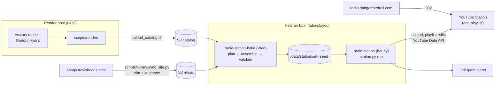

# 📻 Danger Third Rail Radio

**Original music around the clock, over generative visuals no camera ever saw, as a YouTube Station.**

👉 **[radio.dangerthirdrail.com](https://radio.dangerthirdrail.com)** 👈 &nbsp;·&nbsp; 24/7

A [YouTube Station](https://streampush.co/blog/youtube-stations-explained/) is a "live"
stream that YouTube itself plays, 24/7, from one playlist of ordinary videos. Nothing
streams from here. Once a week a box in a Hetzner datacenter bakes a fresh **set**: every
song from [songs.travisbriggs.com](https://songs.travisbriggs.com) exactly once, in a new
order, cut into ~67 short videos, each opening with a station ident and playing two or
three songs over GPU-rendered [vxstory](https://github.com/audiodude/vxstory) pieces
(supernovae, fluid swirls, peg cascades, cities rising from nothing). It uploads them,
and on Friday morning swaps them into the station's playlist. The station loops that
set, about 6.5 hours long, all week.

**One URL, forever.** `radio.dangerthirdrail.com` is a fixed 302 to the station.

---

## 🗓️ A week on air (Pacific time)

| When | What happens |
|---|---|
| **Wed 03:00** | `radio-station-bake.timer`: sync music + catalog from S3, plan the set for Friday, encode every VOD at 1080p60 (~10–16 h), validate, publish to S3, hand it to the station job |
| **hourly** | `radio-station.timer`: upload VODs (unlisted), check YouTube's processing, swap, delete, health-check, alert |
| **Thu 18:00** | Telegram alert if the new set isn't fully uploaded and processed |
| **Fri 06:00** | **Swap**: the new VODs are appended to the playlist in order, then last week's are removed. Not ready? Last week's set keeps playing and the swap happens as soon as it is |
| **Sat** | Last week's videos are deleted |
| **daily** | Health check: the playlist is exactly the live set, in order, every video processed and unlisted |

## 🏗️ How it fits together



| Piece | Where | Job |
|---|---|---|
| **Render** | [`scripts/render/`](scripts/render/) on a GPU machine | Turn vxstory model + preset + seed into 1080p60 mp4s + `catalog.json` |
| **Library** | [`scripts/library/`](scripts/library/README.md) | Mirror the songs site into S3, trimmed and normalized to −21 LUFS |
| **Bake** | [`scripts/bake/`](scripts/bake/) on the box | Plan and encode the week's set into `/data/station/set-<seed>/` |
| **Station** | [`scripts/station/`](scripts/station/) on the box | Uploads, the Friday swap, deletion, health checks, alerts |

## 🎨 Content: rendering the video catalog

Pieces come from the [vxstory](https://github.com/audiodude/vxstory) models
(`supernova_orbit`, `fluid_swirl`, `peg_cascade`, `chromatic_cascade`, `matter_cycle`,
`radial_burst`, `metro_rise`, `hydra`, …), rendered by composable helpers on a machine
with a GPU and a vxstory checkout (`VXSTORY_DIR`, default `../vxstory`):

```bash
# one piece: model, preset, seed, duration, out dir (+ optional --kind ident)
scripts/render/render_piece.sh supernova_orbit odyssey 101 600 ./catalog_1080
# a whole catalog from a committable spec (the on-air one is station-1080.json)
scripts/render/render_catalog.sh scripts/render/specs/station-1080.json ./catalog_1080
# push to S3: mp4s first, manifest last, so the manifest never references missing files
scripts/render/upload_catalog.sh ./catalog_1080 s3://bucket/catalog/
```

- Pieces render at the models' native **1920×1080@60** (Movie Maker captures the project
  viewport, so shrinking it would crop rather than scale). `RENDER_RES` downscales in the
  encode if you ever want smaller files.
- Each mp4 gets a sidecar JSON; `make_manifest.py` collects them into
  `catalog.json`: `{"pieces": [{id, kind: piece|ident, model, preset, seed, duration_sec, file, rendered_at}]}`.
  An optional `title` is the piece's on-screen credit (default: the model in Title Case,
  `Supernova Orbit`).
- Renders are serialized (one GPU), idempotent (existing mp4s are skipped, writes are
  atomic), and run about **6× realtime on a 3080 Ti** (~29 min per 300 s piece, encode included).
- **Hydra** (original Hydra sketches; presets `cells`, `weave`, `glass`, `chrome`, `fold`)
  renders through vxstory's own `hydra/render.mjs` in headless GPU Chromium instead of
  Godot. `render_piece.sh` picks it whenever the model dir has a `render.mjs`. One-time
  setup in the vxstory checkout (Node ≥ 24):
  `cd hydra && npm ci && npx playwright install chromium-headless-shell`.

The next weekly bake picks new pieces up automatically.

### 🪧 Idents

Idents are the station-ID bumpers that open every VOD. They can be rendered
(`--kind ident`) or **hand-made**: drop an mp4 in the catalog dir with a sidecar (`model`
can be anything, e.g. `handmade`). Optional sidecar fields steer the bake:

| Field | Effect |
|---|---|
| `weight` | Relative odds of opening a VOD (default `1`) |
| `filler: true` | May open two VODs in a row (`text_ident_plz_ignore_s1` is the filler, weight 6) |

An ident **with audio** is pre-roll: it plays with its own sound, then the first song
starts. A **silent** ident plays over the start of the first song.

## 🎵 Music library

The S3 library mirrors [songs.travisbriggs.com](https://songs.travisbriggs.com)'s public
`songs.json`. Every upload is trimmed of mastered-in silence and **loudness-normalized,
gain only**, to the on-air level of **−21 LUFS / ≤ −1 dBTP**. The bake plays files as-is.

```bash
python3 scripts/library/sync_site.py           # dry run: + uploads, ~ re-processing, - removals
python3 scripts/library/sync_site.py --apply   # actually change S3
```

`scripts/bake/song_denylist.txt` keeps songs (covers, a few long tracks) off air even when
they're in the library. Full details, including why −21 and not −14:
[`scripts/library/README.md`](scripts/library/README.md).

## 🍞 The bake: how a set gets planned

`scripts/bake/bake.sh` runs **target → plan → assemble → validate → publish → register**.
The plan is deterministic: the seed is the date of the Friday the set goes on air, so a
week's set can always be re-derived.

- **Target**: the coming Friday. Skipped if a set is already waiting, or if the live set
  went on air less than 4 days before that Friday (so a mid-week launch gets a full first
  week). `bake.sh --now` bakes a launch set that swaps in as soon as it's uploaded.
- **Songs**: the whole library in a seeded shuffle, each song **exactly once**, cut into
  **stretches of 2 or 3 songs**, one VOD each.
- **Idents**: one per VOD, drawn by weight, never the same one on two VODs in a row (the
  filler excepted), including from the last VOD back to the first.
- **Uncut vs cut**: each stretch is drawn **uncut** (75%, `UNCUT_SHARE` in
  `scripts/bake/plan.py`), one piece under every song, which is what the 600 s pieces are
  for, or **cut**: a hard cut to a new piece at each song boundary. Uncut needs a piece
  long enough; otherwise it's cut.
- **10-minute cap**: no piece stays on screen longer than `MAX_SEG` (600 s). A longer
  stretch is always cut, and a song that would still outrun the cap cuts mid-song.
- **Rotation**: pieces go least-recently-used across the whole set and never play twice in
  a row, even across VODs and the loop seam. Each segment starts at a random in-point.
- **Titles**: each song's name is burned in as a `♪ Song Title` ASS subtitle that fades in
  and out. The VOD's YouTube title is `Song A / Song B (Render, Render)` (≤ 100 chars:
  every song kept, renders truncated with `...`); the description is the station blurb
  (`/etc/radio-blurb.txt`), the songs with links, and the render credits.
- **Encode**: per VOD, x264 `slow` CRF 18 with a 20 Mbps peak cap (`BAKE_PRESET`,
  `BAKE_CRF`, `BAKE_MAXRATE`), GOP 30, AAC 384 kbps 48 kHz, `+faststart` MP4. The cap keeps
  a set under ~58 GB. VODs are written atomically and skipped on a re-run, so a crashed
  bake resumes (unless the plan changed, which discards them).

Output: `/data/station/set-<seed>/` with `plan.json` + `vod-000.mp4…`, copied to
`$S3_SHOWS_URI/set-<seed>/`. At each swap, every set other than the live one and the one
waiting is pruned, locally and in S3.

## 🛰️ The station job

`scripts/station/station.py run`, hourly, idempotent and resumable at every step. State
lives in `/data/station/state.json` (atomic writes, `flock`).

- **Playlist**: created by the first run (public, `Danger Third Rail radio // Shocking
  Visuals!`, blurb as description) and announced on Telegram; the station is bound to it
  once in Studio. The box owns it: at each swap, anything that isn't the new set goes.
- **Uploads**: resumable, unlisted, category Music, not made for kids, no subscriber
  notification. The session URL is saved before any bytes go out, so a crash resumes
  instead of duplicating. YouTube's per-channel upload cap (`uploadLimitExceeded`) pauses
  uploads for 24 h; failed or rejected processing re-uploads.
- **Thumbnail**: once a VOD is processed it gets the station thumbnail
  ([`assets/station-thumbnail.jpg`](assets/station-thumbnail.jpg), installed on the box as
  `/etc/radio-thumbnail.jpg`; 50 quota units each). A rejected thumbnail alerts once and
  isn't retried.
- **Swap**: append the new set in order, then remove the old items, so the playlist is
  never empty. A swap interrupted halfway finishes on the next run; a playlist found out
  of order is left alone and alerted.
- **Quota**: a swap is ~6,700 of the 10,000 daily units and deleting a set ~3,350, hence
  Friday + Saturday. `quotaExceeded` pauses everything until Pacific midnight.
- **Alerts** (Telegram, each once per incident): bake failure, not ready Thursday evening,
  swap overdue, upload cap, quota, repeated upload/processing failure, health check
  failed/recovered, unexpected errors, and one message per swap.

## 🛠️ Operating it

The [**runbook**](docs/go-live-runbook.md) is the source of truth for deploys and
first-time setup. The greatest hits:

```bash
# what's live, what's waiting, upload/processing progress
ssh radio-playout 'sudo python3 /opt/radio/scripts/station/station.py status'

# run the station job now (uploads, swap if due) and watch it
ssh radio-playout 'sudo systemctl start radio-station.service; journalctl -u radio-station -f'

# bake by hand (normally Wednesday's timer does it)
ssh radio-playout 'sudo systemctl start radio-station-bake.service'
ssh radio-playout 'journalctl -u radio-station-bake -f'
```

**Deploys.** The box runs a checkout of the `release` branch in `/opt/radio`: merge `main`
→ `release` (a regular merge, never a squash), push, then `git pull` there. Ship bake
changes before Wednesday 03:00 PT.

## 🧪 Tests

Decoded-media fixtures and an in-memory YouTube exercise the planner, the encode and the
station job without touching YouTube:

```bash
uv run --with pytest python -m pytest scripts/bake/tests scripts/station/tests -q
```

## 🩹 Scar tissue

Things this station learned the hard way, and the design they left behind:

- **2:17 of dead air.** One "mp3" was actually AIFF/PCM; the concat demuxer can't switch
  decoders mid-stream and decoded it to nothing. Every song is now decoded to identical
  PCM and clamped to its planned slot before concat.
- **YouTube's playlist reads lag its writes.** Right after a swap, `playlistItems.list`
  still returned half the new set. The health check waits 30 minutes after a swap.
- **A set is big.** Uncapped CRF 18 put one 1080p60 render at 39 Mbps; two weeks of that
  doesn't fit on the box. Hence the 20 Mbps peak cap (YouTube re-encodes to far less).
- **No 301s, ever.** Browsers cache 301s forever; the redirect is a 302.

## 📚 More docs

- [Runbook](docs/go-live-runbook.md): content, first-time setup, deploys, kill switch
- [Music library tools](scripts/library/README.md): sync, normalization, silence cleanup
- [Design specs and plans](docs/superpowers/): the station design and its predecessors
- [TODO.md](TODO.md): content and infrastructure roadmap

---

## 🦴 Fossil record

<details>
<summary>📡 The daily live broadcast (June → November 2026)</summary>

Before the station, the box streamed a pre-baked six-hour show to YouTube Live every day,
12:00–18:00 PT, and a Railway monitor owned the broadcast. Every night a 03:00 bake
planned a ~6.3 h show and stream-copied it over RTMP; at 11:45 a 16-minute countdown went
up, and the monitor created the day's broadcast, released the music only once YouTube
reported it `live` with an active stream, and flipped `radio.dangerthirdrail.com` between
an offline title card and that day's new video ID (a reconciled S3 routing rule + a
CloudFront invalidation). Its lessons: never let the encoder starve ("the stream dies
after ~30 s"); bind broadcasts by stream key with pinned metadata, not cloned from the
newest broadcast (a test key once hijacked production); create broadcasts with
`enableMonitorStream` off (403 `invalidTransition`); give scripted clients a real user
agent behind Cloudflare. Its code (`scripts/broadcast/`, `scripts/bake/opening.py`, `monitor/`) was removed at
the station cutover; it lives in git history.

</details>

Before vxstory, this station was a **Godot Galton board** (a bean machine raining balls
into a bell curve, with live chat reactions) streamed 24/7 from Railway. Its code is still
here; its Railway `galton-stream` service and volume were deleted on 2026-10-18.

<details>
<summary>🎲 Galton board simulator (Godot 4.4+)</summary>

Balls spawn from a funnel, bounce through 12 rows of pegs between concave walls, and
collect in bins that blend the colors of every ball they catch (2–3 random colors per
round). A histogram overlay tracks the curve, pegs flash when touched, and the board
resets after 472–512 balls.

```bash
godot --path . --main-scene main.tscn   # ESC quits
```

**Chat IPC.** A Python chat service writes a JSON array of events to `/tmp/chat_events.json`
(`CHAT_EVENTS_FILE`) atomically (write `.tmp`, rename); Godot reads and deletes it every
second.

```json
[
  {"type": "join", "name": "UserName", "time": 1712345678.9},
  {"type": "message", "name": "UserName", "text": "hello!", "time": 1712345678.9},
  {"type": "gift", "name": "UserName", "amount": "$10", "time": 1712345678.9}
]
```

```bash
python3 scripts/mock_youtube.py [--joins-only|--gifts-only] [--interval 3] [--burst 5]
YOUTUBE_API_KEY=... YOUTUBE_VIDEO_ID=... python3 scripts/chat_poller.py
```

**Music.** `start.sh` synced MP3s from `S3_MUSIC_BUCKET` to `/data/mp3`;
`scripts/music_player.py` decoded a shuffled loop to raw PCM in `/tmp/audio_pipe` for
FFmpeg and wrote the title to `/tmp/current_song.txt`, which `scripts/song_display.gd`
showed as "♪ Song Title" (full opacity 5 s, fading to 0.4 over 10 s).

**Container.**

```bash
docker build -t galton-stream .
docker run -e YOUTUBE_STREAM_KEY=... -e S3_MUSIC_BUCKET=s3://bucket/path/ \
           -e AWS_ACCESS_KEY_ID=... -e AWS_SECRET_ACCESS_KEY=... galton-stream
```

Godot ran headless under Xvfb, captured by FFmpeg at 720p30 with audio.

**Recovery escalation.** The old monitor polled galton-stream's `/health` every 120 s:
1 fail → fallback image stream, 5 → container restart, 6 → Railway redeploy, 7 → alert.

</details>

<details>
<summary>🎞️ Raw-pipe video player (scripts/playout/), the pre-bake prototype</summary>

The first vxstory playout mirrored the music architecture: `video_player.py` decoded
catalog pieces to raw frames in `/tmp/video_pipe`, and `playout.sh` ran a master ffmpeg
muxing video pipe + audio pipe + a `drawtext` song title to FLV (a file, or RTMP when
`YOUTUBE_STREAM_KEY` is set).

Its key idea was the **pacer**: one wall-clock thread owns every write to the video pipe,
emitting the latest decoded frame at a 60 fps ceiling from an always-full slot, so the
master ffmpeg never starves (the fix for "stream dies after ~30 s"). Cuts happened at the
first song boundary after `DWELL_SEC`, through a random ident.

```bash
DWELL_SEC=900 CATALOG_DIR=./catalog OUTPUT=./playout_test.mp4 scripts/playout/run_local.sh
```

| Variable | Default | Description |
|---|---|---|
| `CATALOG_DIR` | `./catalog` | Dir containing mp4s + `catalog.json` |
| `VIDEO_PIPE` / `AUDIO_PIPE` | `/tmp/video_pipe` / `/tmp/audio_pipe` | Named pipes into the master ffmpeg |
| `SONG_FILE` | `/tmp/current_song.txt` | Song-boundary detection + drawtext overlay |
| `DWELL_SEC` | `900` | Minimum piece play time before a boundary can cut it |
| `OUTPUT` | `./playout_test.flv` | File path, or RTMP URL (auto when `YOUTUBE_STREAM_KEY` set) |

Start pipe writers first and the master ffmpeg last: pipe opens block until both ends exist.

</details>
